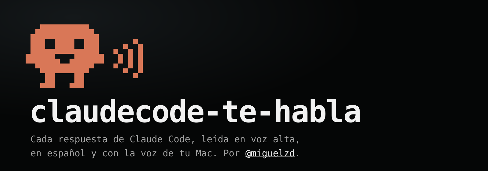

# Claude Code te habla



Plugin de [Claude Code](https://claude.com/claude-code) que **lee en voz alta cada respuesta** apenas
termina, en español, con la voz Paulina de macOS. Para escuchar a Claude mientras hacés otra cosa.

## 💡 Ideal para los que trabajamos en la terminal o en VS Code

Mientras Claude trabaja, vos hacés otra cosa, y te enterás de lo que respondió sin volver a mirar la
pantalla.<br>
Usa sólo lo que ya trae la Mac: nada de servicios externos, claves ni voces para descargar aparte.

## Qué hace

1. Cuando Claude termina de responder, toma el texto de la respuesta.
2. Le saca lo que no se puede leer: bloques de código, asteriscos, títulos, tablas y links.
3. Si todavía estaba leyendo la respuesta anterior, la corta, para que no se encimen.
4. La lee con `say`, el lector de voz de macOS.

## Ventajas

- **Lee la respuesta completa**, tal como la escribió Claude: no un resumen hecho por otro modelo.
- **No gasta tokens.** No llama a ningún modelo ni a ninguna API: cada lectura es gratis.
- **Anda sin internet.** La voz es de la Mac, así que el audio se arma ahí mismo.
- **Nada que instalar ni configurar.** Usa `say`, que ya viene con macOS; se instala y anda.
- **Pensado para el español.** Paulina por defecto, y una limpieza del texto para que no se lean
  símbolos ni se corte la lectura en medio de una respuesta.
- **Simple de revisar.** Es un solo script de bash de unas 50 líneas: se puede leer entero antes de
  instalarlo.

## Requisitos

- **macOS.** No anda en Windows ni en Linux.
- **Claude Code**, en la terminal, en VS Code o en otro lugar donde corra en tu Mac. No funciona en
  el chat de la aplicación de escritorio de Claude.
- **La voz Paulina.** Si no la tenés: Configuración del Sistema → Accesibilidad → Contenido leído →
  Voz del sistema → Administrar voces → Español (México) → Paulina.
- **`jq`.** Viene con macOS 15 Sequoia o posterior. En versiones anteriores: `brew install jq`.

Para ver si tenés la voz:

```bash
say -v "Paulina (Español (México))" "Hola, te hablo yo"
```

## Instalar

Dentro de Claude Code:

```
/plugin install claudecode-te-habla --marketplace miguelzd/claudecode-te-habla
```

En versiones de Claude Code anteriores a la 2.1.275, en dos pasos:

```
/plugin marketplace add miguelzd/claudecode-te-habla
/plugin install claudecode-te-habla@claudecode-te-habla
```

Después, reiniciá Claude Code. Desde la próxima respuesta, la vas a escuchar.

## Cambiar la voz o la velocidad

En `~/.claude/settings.json`, dentro del bloque `"env"` (si no existe, se crea):

```json
{
  "env": {
    "CLAUDE_TE_HABLA_VOZ": "Paulina (Enhanced)",
    "CLAUDE_TE_HABLA_VELOCIDAD": "185"
  }
}
```

- **Voz:** cualquiera de las que lista `say -v '?'`. Por defecto, `Paulina (Español (México))`.
- **Velocidad:** en palabras por minuto. Por defecto, `185`.

## Desinstalar

```
/plugin uninstall claudecode-te-habla@claudecode-te-habla
```

## Para tener en cuenta

- **Si tenés varias sesiones de Claude Code abiertas, hablan todas.** La que termina última corta
  a la anterior, así que no se enciman, pero puede hablarte una sesión que no estás mirando.
- **No anda en el chat de claude.ai ni en la app del celular**: los plugins son de Claude Code.
- Si ya tenías tu propio hook de voz en `settings.json`, sacalo: con los dos activos, cada
  respuesta se lee dos veces.

## Licencia

[MIT](LICENSE) © 2026 Miguel Angel Zdanovich
